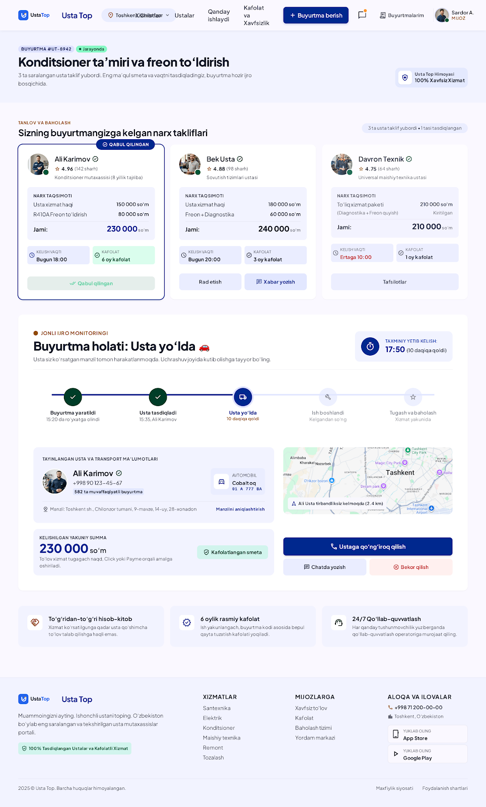
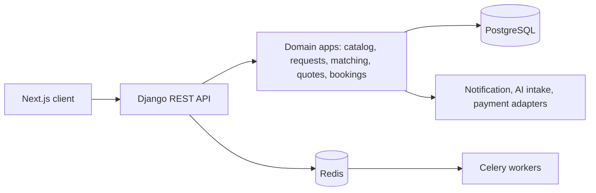

# Usta Top

      

## Overview

Usta Top is a service marketplace connecting customers with local home-service providers. The repository contains a modular Django REST API and a Next.js frontend. Its workflow covers service requests, provider matching, quotes, bookings, conversations, reviews, disputes, and administrative operations.

## Main features

- Customer, provider, administrator, and moderator roles.
- Location hierarchy, service catalog, provider profiles, and portfolios.
- Service request intake and weighted provider matching.
- Quote acceptance and booking creation, including transaction/concurrency safeguards.
- Booking lifecycle, conversations, favorites, reviews, and dispute handling.
- Provider verification workflow and notifications.
- AI intake module for text/voice input; rule-based components and configured integrations should be distinguished in deployment documentation.
- Payment and escrow abstractions with Payme/Click adapter modules. The current adapters include mock behavior and do **not** constitute production payment processing.

## Screenshots

The repository includes these UI images:

| Screen | Preview |
|---|---|
| Landing page |  |
| Provider search |  |
| Providers |  |
| Booking flow |  |

## Technology stack

| Layer | Technology |
|---|---|
| Backend | Python, Django REST Framework, SimpleJWT, modular Django apps |
| Frontend | Next.js 16, React 19, TypeScript, React Query, React Hook Form, Zod, Tailwind CSS |
| Data and jobs | PostgreSQL, Redis, Celery |
| API docs | OpenAPI via drf-spectacular, Swagger UI, ReDoc |
| Local operations | Docker Compose, Nginx |

## Architecture



The backend is a modular monolith. Domain code is grouped under `backend/apps/`; shared API behavior and environment-specific settings live in `backend/config/` and `backend/common/`. Frontend source is under `frontend/`.

## Repository layout

```text
backend/     Django REST API, domain apps, migrations, and tests
frontend/    Next.js/React/TypeScript application
docker/      Nginx configuration
docs/        Architecture and API notes
docker-compose.yml
```

## Installation

### Backend

```bash
cd backend
python -m venv .venv
source .venv/bin/activate
pip install -r requirements/local.txt
cp .env.example .env
python manage.py migrate
python manage.py runserver
```

### Frontend

```bash
cd frontend
npm ci
npm run dev
```

Set the frontend API base URL using the environment variable documented by the frontend configuration. For a complete local stack, review the root Docker Compose file and configure PostgreSQL, Redis, and integration credentials.

## Environment variables

Use `backend/.env.example` as the variable-name reference and put real values only in an untracked local `.env` or managed secret store.

| Variable group | Purpose |
|---|---|
| `SECRET_KEY`, `DEBUG`, `ALLOWED_HOSTS` | Django runtime and host security |
| `DATABASE_URL` | Database connection |
| `REDIS_URL`, Celery settings | Cache and background tasks |
| JWT settings | Access/refresh token behavior |
| Telegram settings | Bot notifications, if enabled |
| `OPENAI_API_KEY` | Optional AI integration |
| Payme/Click variables | Adapter configuration; does not mean live payment verification is implemented |
| AWS/S3 variables | Optional object storage |

## API documentation

With the backend running, open **`/api/docs/`** for Swagger UI, **`/api/redoc/`** for ReDoc, or **`/api/schema/`** for the OpenAPI schema. Health endpoints are **`/health/`** and **`/health/ready/`**. The endpoint groups are mounted below `/api/v1/`.

## Data model

Core concepts include users and roles, locations, service categories, providers and portfolios, service requests, matching results, quotes, bookings and lifecycle history, conversations, reviews, favorites, disputes, verification records, notifications, promotions, and payment records.

## Usage

1. Register or authenticate as a customer/provider.
2. Browse locations, categories, and provider profiles.
3. Create a service request, review matched providers and quotes, and accept a quote to create a booking.
4. Continue through booking status, conversation, review, or dispute flows as permitted by the account role.

Consult the generated API schema for exact payloads and authorization requirements.

## Deployment

The repository provides Dockerfiles, a Docker Compose stack, and Nginx configuration. Use the Compose setup for a self-managed environment, or deploy the Next.js frontend and Django API as separate services after configuring their environment variables and network origins. No Vercel or Railway project connection is confirmed by repository configuration alone.

## Security notes

- The payment integrations currently contain mock escrow behavior and webhook verification that accepts requests unconditionally. Do not process real payments until verification is implemented and reviewed.
- Remove development secret fallbacks; set `DEBUG=False`, exact allowed hosts, CORS origins, and strong unique secrets.
- Keep identity documents and provider verification data private, access-controlled, and retention-limited.
- Do not put integration secrets in README files, screenshots, seed data, or source control.

## Tests

Backend test modules cover authentication, domain flows, and concurrency-related behavior. Run them in the configured backend environment with the repository's test runner. No test results are claimed by this draft.

## Future improvements

- Implement and test Payme/Click webhook signature verification and real payment-provider flows.
- Replace mock escrow with a documented provider-backed or explicitly simulated workflow.
- Add CI checks and document exact backend/frontend test commands.
- Add a deployment example with separate frontend/API domains and secure environment settings.
